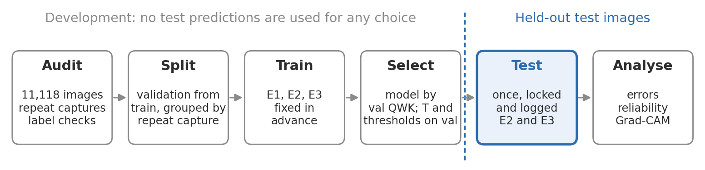

# Explainable diabetic retinopathy grading on MMRDR-CFP

**Research prototype. Not for clinical use.** Built as the practical assessment for the Aston University and Boots Opticians KTP Associate post (ref. 1443-26). It makes no claim of clinical validity.

## At a glance

A five-grade diabetic retinopathy classifier (EfficientNet-B0, 512 px) on the MMRDR colour fundus photographs, evaluated once on the held-out test set, with calibration, referral of uncertain cases, and Grad-CAM maps tested for faithfulness. The report is in `report/` (`report.tex` and its figures); every design decision, the alternatives and the evidence are in `DECISIONS.md`.



## Reproduce the results

There are three levels, from fastest to most complete.

**A. Every number in the report, from the saved outputs (about a minute, no dataset, no GPU).**

Use Python 3.10 to 3.12.

```bash
pip install -r requirements.txt
PYTHONPATH=src python scripts/reproduce_report.py
```

This reruns the project's own evaluation, calibration and referral code on the predictions committed in `results/predictions/`, and prints each report number next to the recomputed value. It ends with "95 of 95 report numbers reproduced". The saved test predictions are checked against the committed test locks and access log before use, so a changed file is refused. Explainability numbers need the images and the model, so they are read from `results/explain/`.

**B. The same predictions from the trained models (needs the dataset; CPU is enough).**

The two models evaluated on test are committed in `models/` (`best.pt`, with the `config.yaml` and `env.json` of the training run). Download MMRDR (see [Dataset](#dataset)), then:

```bash
export MMRDR_ROOT=/path/to/folder/containing/MMRDR-CFP
PYTHONPATH=src python scripts/preprocess.py --config configs/data.yaml --workers 4
for run in e2_effb0_512_ce e3_effb0_512_wce; do
  PYTHONPATH=src python scripts/predict.py --run models/$run --subset val
  PYTHONPATH=src python scripts/predict.py --run models/$run --subset test --final --force --reason "independent reproduction"
  PYTHONPATH=src python scripts/check_predictions.py --run models/$run
done
```

`check_predictions.py` compares the new predictions with the committed ones. On CPU they are identical (largest logit difference 0.0 in our check); on a GPU, rounding can differ very slightly. `--force --reason` is needed because the committed access log already records the original test run; the reproduction is added to `results/test_access_log.jsonl`, so it stays visible.

**C. Retrain from scratch (needs a GPU).** Follow the stages below. GPU training is not bit-for-bit repeatable: three runs of the selected recipe (seeds 42 and 43, on a Colab T4 and an RTX 6000 Ada) gave validation QWK from 0.926 to 0.932 (`results/compare/val_comparison_extras.csv`), so expect differences of that size.

Commit IDs recorded in the run files (`env.json`, the test locks, `results/MANIFEST.json`) refer to the development history before it was combined into one commit.

## Setup

Python 3.10, 3.11 or 3.12 (the pinned torch 2.5.1 and torchvision 0.20.1 have no Python 3.13 wheels). Stage 1 needs only the first block of `requirements.txt`.

```bash
python3 -m venv .venv
. .venv/bin/activate
pip install -r requirements.txt   # installs torch and timm too; only needed from stage 4
pip install -e .                  # installs the drgrade package from src/
```

The commands below set `PYTHONPATH=src`, which also works without the editable install.

## Dataset

MMRDR is downloaded separately from figshare: https://figshare.com/articles/dataset/MMRDR/29423747 (DOI 10.6084/m9.figshare.29423747.v2, licence CC BY 4.0). It comes as nine parts (`MMRDR.zip.001` to `.009`, about 18.6 GB in all); join and extract them (for example `cat MMRDR.zip.0* > MMRDR.zip && unzip MMRDR.zip`, or open `.001` with 7-Zip). `MMRDR-CFP/` must contain `img/` and `FP.csv`. Set the root in `configs/data.yaml` (`mmrdr_root`) or export `MMRDR_ROOT`, which points at the folder that contains `MMRDR-CFP/`. Only the colour fundus subset is used.

Dataset paper: Z. Tang et al., "A multimodal retinal image dataset for diabetic retinopathy detection using foundation models", *Scientific Data* 13, 639 (2026). The fundus photographs come from the OIA-DDR dataset (T. Li et al., *Information Sciences* 501, 2019). No images are committed. `results/` holds per-image metadata (grades, lesion flags, crop box, border level and quality measures) and model predictions derived from MMRDR, shared under CC BY 4.0 with attribution.

## Stage 2: preprocessing

```bash
PYTHONPATH=src python scripts/preprocess.py --config configs/data.yaml --workers 4 --max-seconds 150
```

Each image is cropped to the fundus, padded to a square, resized to 512 px with area averaging and saved as a JPEG at quality 95 in `data/processed/s512/`. The folder also holds `manifest.csv` (labels, crop box, quality measures), and `preprocess_info.json` (settings, counts, git commit).

The VM stops any command after about 170 seconds, so the run is split. Rerun the same command until it exits with status 0. Exit status 3 means the run stopped at `--max-seconds` with work left: run the same command again. Progress is kept in `manifest_partial.csv` after each batch, and finished images are skipped. Use `--overwrite` to rebuild from scratch. If the settings in `configs/data.yaml` change, the run stops with status 2 and asks for `--overwrite` (`DECISIONS.md` D12).

When the run exits with status 0, package the folder for upload to Google Drive:

```bash
PYTHONPATH=src python scripts/preprocess.py --config configs/data.yaml --zip
```

This writes `data/processed/s512.zip` with the images stored uncompressed. It also writes `outputs/preprocess/contact_processed.png`, a visual check of 24 processed images. A `--limit N` run writes to `data/processed/s512_limit<N>/` and is only for smoke tests.

The quality measures and the choice of 512 px are recorded in `DECISIONS.md` D09 to D11. Ben Graham normalisation exists behind the `ben_graham` flag and is off by default.

## Stage 1: data audit

```bash
PYTHONPATH=src python scripts/audit.py --config configs/data.yaml --workers 4
```

Outputs go to `outputs/audit/`: `summary.json` (every number), CSV tables and PNG figures. Add `--reuse-cache` to reuse `images.csv` and `vessel_signatures.npz`, and `--limit N` for a quick partial run. Decisions are recorded in `DECISIONS.md`.

Near-duplicates are found with a vessel-pattern signature rather than a perceptual hash (`DECISIONS.md` D03). Each image gets a 64 by 64 vector from the high-pass green channel inside the fundus, and pairs are compared by cosine similarity at `vsig_threshold` in `configs/data.yaml`. The signature detects repeat images of the same eye. It does not detect other images of the same patient, because the dataset has no patient identifiers.

The stage 1 near-duplicate outputs are:

- `near_duplicate_pairs.csv`: every reported pair, with similarity, whether the files are byte-identical, splits and grades.
- `dup_clusters.csv`: members of groups of two or more images.
- `grade_disagreement_groups.csv`: groups whose members carry different grades. Labels are reported, never changed (`DECISIONS.md` D07).
- `vessel_signatures.npz`: the signatures, cached with the image ids and settings they were computed from.
- Contact sheets: cross-split pairs, the threshold boundary, and grade disagreements.

The per-image pass can be split across several runs with `--max-seconds S` (which exits with status 3 when the time runs out) and then `--resume`. The signature pass is not resumable.

## Stage 3 and 4: training

The data pipeline (`src/drgrade/data.py`), models (`models.py`), losses (`losses.py`) and the training loop (`train_loop.py`) run from `scripts/train.py`. Each run writes to `runs/<run_name>/` (git-ignored): `config.yaml`, `env.json`, `history.csv`, `last.pt`, `best.pt`, `val_predictions.csv` and `summary.json`. Checkpoints are never committed. Training uses the train and validation subsets only. The test subset is refused by the loader (`DECISIONS.md` D21).

Local smoke test. It needs the processed images from stage 2 in `data/processed/s512/`. It runs on CPU with random initial weights, so it downloads nothing:

```bash
PYTHONPATH=src python scripts/train.py --config configs/e3_effb0_512_wce.yaml --data-config configs/data.yaml --smoke --no-pretrained --num-workers 0 --batch-size 2
```

The smoke test uses 64 training and 32 validation images for two epochs. It checkpoints after epoch 1, resumes for epoch 2 in the same process, and fails unless `history.csv` has two rows. The output goes to `runs/smoke_e3_effb0_512_wce/`. The VM stops any command after about 170 seconds, so a 512 px smoke run may need to be repeated. A smoke run clears its own output folder before it starts.

Full training runs on Google Colab, with the thin runner `notebooks/colab_train.ipynb`. The one-time setup is in the notebook. Choose the run in its settings cell, then run the cells in order. Training writes to `My Drive/explainable-dr-grading/runs/<run>/`. A disconnected run is resumed by running the last cell again, because the command passes `--resume`.

Determinism. The seeds and the deterministic settings are in `seed_everything` (`DECISIONS.md` D18). Resume reproduces an uninterrupted run exactly on CPU with no DataLoader workers, which the test suite checks. With workers, the augmentation draws after a resume are not guaranteed to match an uninterrupted run (D20). Results may differ slightly between CUDA, MPS and CPU, so each reported number comes from the device recorded in its `env.json`. Mixed precision is used on CUDA only (D17).

## Stage 5 and 6: prediction, evaluation, error analysis

Run these in order. `$RUN` is the run chosen on validation, for example `runs/<run_name>`. Commands that can exceed the VM's time limit (about 170 seconds) must be repeated until they exit with status 0: exit status 3 means `--max-seconds` stopped the run with work left, and the same command resumes from `<output>.partial.csv`. Set `PYTHONPATH=src` before each command.

1. Leakage list (needs the audit outputs in `outputs/audit/`). Writes `splits/test_with_train_copy.csv`, which is committed (`DECISIONS.md` D22):

   ```bash
   python scripts/make_leakage_list.py
   ```

2. Compare the runs on validation. This reads each run's `val_predictions.csv` and states which run the pre-declared rule selects (highest validation QWK, ties by macro-F1, `DECISIONS.md` D16). Output: `outputs/compare/val_comparison.{csv,md}`:

   ```bash
   python scripts/evaluate.py --compare --pred runs/e1_resnet18_384_wce/val_predictions.csv runs/e2_effb0_512_ce/val_predictions.csv runs/e3_effb0_512_wce/val_predictions.csv
   ```

3. Decide test-time augmentation on validation only (`DECISIONS.md` D24). Predict validation with and without TTA for the selected run, then evaluate both:

   ```bash
   python scripts/predict.py --run $RUN --subset val --max-seconds 150
   python scripts/predict.py --run $RUN --subset val --tta --max-seconds 150
   python scripts/evaluate.py --pred $RUN/predictions/val.csv
   python scripts/evaluate.py --pred $RUN/predictions/val_tta.csv
   ```

4. The single locked test prediction (`DECISIONS.md` D23, D38). Only the runs in `configs/test_allowlist.yaml` (E2 and E3) can be predicted on test. Each command writes an "attempt" line to `results/test_access_log.jsonl` before it reads any test image, and a "complete" line with the CSV hash when the file is finished; a completed run and variant cannot be repeated in any folder without `--force --reason TEXT`. Plain first, then TTA if step 3 chose it (it did not, D37), then close the lock and copy it to `results/`:

   ```bash
   python scripts/predict.py --run $RUN --subset test --final --max-seconds 150
   python scripts/predict.py --run $RUN --subset test --final --tta --max-seconds 150     # only if TTA was chosen on validation
   python scripts/predict.py --run $RUN --close-lock
   cp $RUN/TEST_LOCK.json results/TEST_LOCK_$(basename $RUN).json
   ```

5. Evaluate the test predictions, plain first (the test evaluation needs the leakage list from step 1):

   ```bash
   python scripts/evaluate.py --pred $RUN/predictions/test.csv
   python scripts/evaluate.py --pred $RUN/predictions/test_tta.csv     # only if TTA was chosen
   ```

6. Error analysis. Validation during development, and the test set once for the report (`--out` picks another folder):

   ```bash
   python scripts/error_analysis.py --pred $RUN/predictions/val.csv
   python scripts/error_analysis.py --pred $RUN/predictions/test.csv
   ```

7. Training curves for all runs. Output: `outputs/compare/training_curves.{png,csv}`:

   ```bash
   python scripts/plot_training.py --runs-dir runs
   ```

Pass `--max-seconds 150` to every prediction command on the VM, so that each command returns before the 170 second limit; on a machine with no limit, omit it. If the VM runs out of memory, lower `--batch-size` (the default is 16). Outputs of `scripts/predict.py` are in `<run>/predictions/`. Each evaluation writes `eval_<name>/` next to its predictions (metrics, per-class and confusion tables, a confusion heatmap, and bootstrap intervals). Error analysis writes `errors_<name>/`, with the error table, lesion and quality strata, dangerous misses, representative cases and contact sheets. Forced test reruns need `--force --reason TEXT` and are listed in `<run>/TEST_LOCK.json`. Every predictions CSV gets a sidecar `<file>.meta.json` (subset, run, checkpoint hash, rows, CSV hash); the evaluation, error-analysis, calibration and referral scripts check it, and refuse a truncated file or a test file that is not in the access log and the lock. Without `--device`, prediction uses CUDA, then MPS, then CPU, as training does. Results can differ slightly between devices (`DECISIONS.md` D18).

## Stage 7: reliability

Set `PYTHONPATH=src` before each command, from the repository root. `$RUN` is the run chosen on validation (the same commands work for the secondary model, `runs/e3_effb0_512_wce`). Everything here uses validation predictions, except the test rows, which read the locked test prediction from stage 5 step 4 and must not be run before it exists. The temperature is fitted on validation logits only (`DECISIONS.md` D28), and the referral thresholds are chosen on validation by the rules in `DECISIONS.md` D30 (the test set only receives the fixed thresholds).

1. Calibration. Fits the temperature on `$RUN/predictions/val.csv` (the CPU prediction from stage 5, the same code path as test; not the training-time `val_predictions.csv`, `DECISIONS.md` D38) and writes `$RUN/calibration/` (`calibration.json`, calibrated predictions, `reliability_bins.csv`, reliability diagrams). Run the first command after training; add the test file once it exists, which only reports the test calibration metrics:

   ```bash
   python scripts/calibrate.py --run runs/e2_effb0_512_ce
   python scripts/calibrate.py --run runs/e2_effb0_512_ce --test runs/e2_effb0_512_ce/predictions/test.csv
   ```

2. Referral by confidence and the referable-threshold analysis. Reads the temperature from step 1 and writes `$RUN/referral/` (`referral.json`, `referable_threshold.json`, risk-coverage tables and figures). `--match-sensitivity-of` sets the referable threshold of E2 to E3's validation sensitivity (`DECISIONS.md` D32). Run the first command before the test file exists; the second applies the fixed thresholds to the test predictions:

   ```bash
   python scripts/referral.py --run runs/e2_effb0_512_ce --match-sensitivity-of runs/e3_effb0_512_wce/predictions/val.csv
   python scripts/referral.py --run runs/e2_effb0_512_ce --match-sensitivity-of runs/e3_effb0_512_wce/predictions/val.csv --test runs/e2_effb0_512_ce/predictions/test.csv
   ```

3. Image-quality stress test on validation (`DECISIONS.md` D33). It runs the model on blurred and darkened validation images, one file per level, plus the unperturbed baseline, and writes `$RUN/quality_stress/` (`summary.csv`, `quality_stress.png`). The command stops at `--max-seconds` with status 3; run the same command again until it exits with status 0:

   ```bash
   python scripts/quality_stress.py --run runs/e2_effb0_512_ce --max-seconds 150
   ```

Natural image quality is not in this stage. Metrics by quartile of brightness, contrast and sharpness come from the stage 6 error analysis (`errors_val/quality_stratified.csv`, written by `scripts/error_analysis.py --pred $RUN/predictions/val.csv`).

## Stage 8: explainability

Grad-CAM on the selected model, with sanity and faithfulness checks (`DECISIONS.md` D39, D40). Settings are in `configs/explain.yaml`; outputs go to `$RUN/explain/`. Commands that take `--max-seconds` stop with status 3 at the limit; run the same command again until it exits with status 0.

```bash
RUN=runs/e2_effb0_512_ce
python scripts/explain.py maps --run $RUN --subset val --max-seconds 150          # Grad-CAM for every validation image
python scripts/error_analysis.py --pred $RUN/predictions/val.csv                 # if errors_val/ does not exist yet
python scripts/explain.py panels --run $RUN --subset val                         # case figures
python scripts/explain.py maps --run $RUN --subset test --ids-from $RUN/predictions/errors_test/cases.csv
python scripts/explain.py panels --run $RUN --subset test
python scripts/explain.py randomisation --run $RUN --max-seconds 150             # model randomisation test
python scripts/explain.py deletion --run $RUN --max-seconds 150                  # deletion test
python scripts/explain.py stats --run $RUN                                       # shortcut check and lesion relation
```

On test, only the representative cases are explained. The run must be in `configs/test_allowlist.yaml`, the locked test predictions must pass the provenance check, and every read of test images is logged in `results/test_access_log.jsonl`.

## Tests

```bash
PYTHONPATH=src python -m pytest -q
```

The tests use synthetic data and do not need the dataset.

## Acknowledgements

ImageNet-pretrained weights from `timm` (`efficientnet_b0.ra_in1k`, `resnet18.a1_in1k`), with PyTorch, torchvision, NumPy, pandas, scikit-learn, SciPy, Pillow and matplotlib. Grad-CAM, the vessel-pattern signature and the explainability checks are implemented in this repository.

Developed with the help of AI coding tools.

## Licence

Code: MIT (see `LICENSE`). MMRDR: CC BY 4.0 (cite the dataset paper above). The committed models are trained on MMRDR and are shared for reproduction of this assessment only; they are not for clinical use.